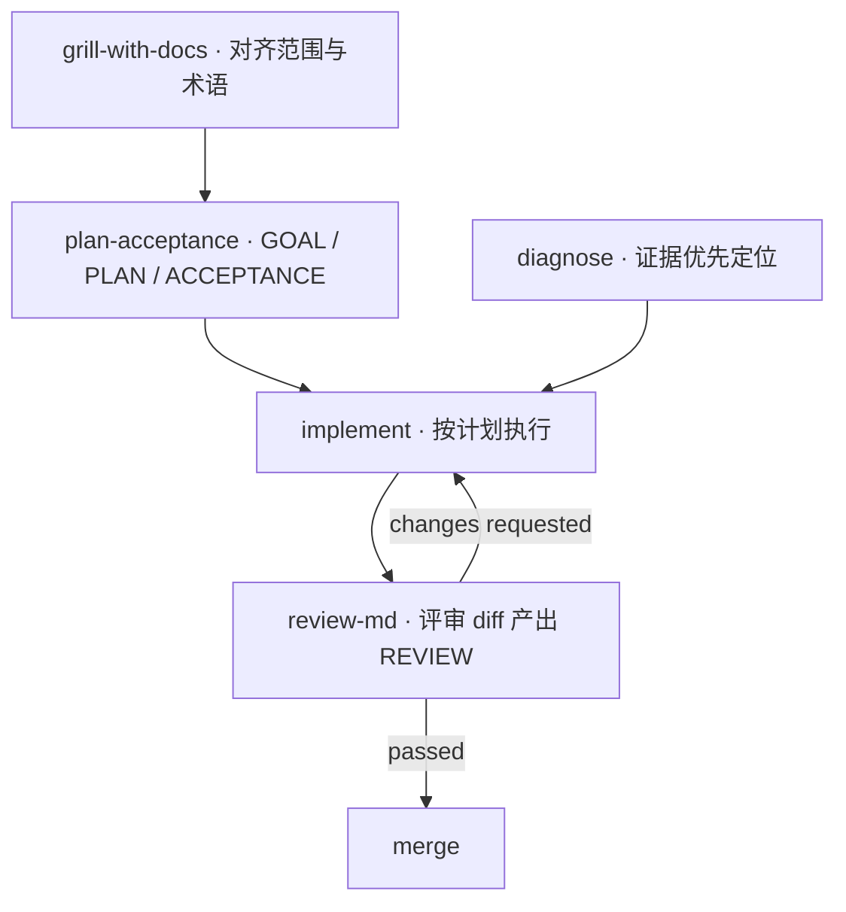
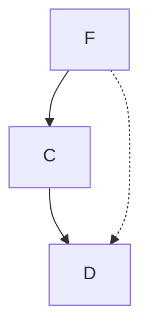
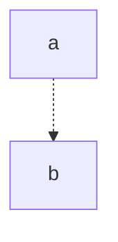

**我把「让 AI agent 可靠干活」需要的那层工程基础设施做出来。**

跨 agent 的 skill 分发、可复盘的协作流程、能长期跑的数据管道。

  
  
  

📍 China · 后端与全栈为主，AI 工程化为重点 · 生产代码在私有仓库，公开仓库是可复用的工具与流程

---

## Featured Work / 精选项目

<table>
<tr>
<td width="50%" valign="top">

### 🧩 [agent-skills](https://github.com/EastDong314/agent-skills)

**一套 skill，装进所有 agent。** 把散落在各台机器上的个人 agent skill 收拢成一个仓库：`git clone` + `./install.sh`，DSH / Codex / pi / Claude Code / OpenCode 立刻拿到同一套能力。

- 覆盖 **6 类 agent 目标**，默认写入跨 agent 共享池 `~/.agents/skills`
- 覆盖前自动备份到带时间戳目录，`--dry-run` / 软链模式 / 按名装单个 skill
- 自带 `check-skills.py`：校验 frontmatter、`name` 与目录一致性、硬编码路径、引用文件是否存在、Python 可编译

`Python` · `Bash`

</td>
<td width="50%" valign="top">

### 🔁 [AI-Project-Workflow-Template](https://github.com/EastDong314/AI-Project-Workflow-Template)

**把「两个模型怎么协作」写进文件，而不是留在聊天记录里。** Codex 负责对齐、规划、验收、评审；pi 负责实现、验证、修 bug。

- **5 个 skill** 串成闭环：`grill-with-docs` → `plan-acceptance` → `implement` → `review-md`，出问题先走 `diagnose`
- 项目状态沉淀为 `.ai-workflow/{GOAL,PLAN,ACCEPTANCE,REVIEW}.md`，可交接、可回溯
- 含可直接复制的仓库模板与 public-safe 的 pi 配置，新项目一条 PowerShell 命令初始化

`PowerShell` · `Markdown`

</td>
</tr>
<tr>
<td width="50%" valign="top">

### 🕸️ [SourceMesh](https://github.com/EastDong314/SourceMesh)

**给下游系统供数的采集中枢。** 基于 Playwright 的多源采集服务，为 TradingP / SignalReactor 提供可复用的行情与市场情报。

- 9 个模块 / ~670 行 TypeScript，CLI 一行命令按源采集或全量采集
- cron 调度 + 多源配置化（selector / 字段映射），加一个源只改 `config.ts`
- 三档存储：PostgreSQL（Prisma）/ Redis / 内存，按部署环境切换

`TypeScript` · `Playwright` · `Prisma` · `PostgreSQL` · `Redis`

</td>
<td width="50%" valign="top">

### 📟 [esp32-s3-desk-terminal](https://github.com/EastDong314/esp32-s3-desk-terminal)

**一块常亮的桌面终端，不是缩水版手机 App。** LCKFB SZPI ESP32-S3（16MB Flash / 8MB PSRAM / 2.0" ST7789 + FT6336 触摸 / ES7210 + ES8311 音频）：盯合约行情、背单词卡、AI 翻译、随手录音。

- **951 行规格文档**：产品/设计/后端/硬件/极客多角色分析 + 板级验证笔记 + roadmap
- 明确的工程边界：固件不存交易所私钥、不存 AI API key，行情只读展示
- 本地优先：断网时卡片复习与录音照常可用

`ESP-IDF` · `C` · `硬件`

</td>
</tr>
</table>

---

## Architecture / 这套东西怎么串起来

> 规划与实现由不同模型承担，中间用文件交接。状态在仓库里，不在聊天记录里——换个会话、换个人接手都能继续。

---

## At a Glance / 一目了然

---

## Tech Stack / 技术栈

**Languages**

**Backend & Data**

**Infra & Delivery**

**AI & Agents**

---

## How I Work / 工作方式

- **Design for failure** — 幂等、重试策略、优雅降级，先假设会挂
- **Measure before optimize** — 先 profile 再调优，不猜
- **Automate the boring part** — 把重复动作固化成脚本、模板、skill
- **Write it down** — 决策与权衡落成文档，下次不用重新想

> 私有仓库里是业务系统（高并发订单、内部运营平台、AI 辅助知识流）；公开仓库里是这些系统磨出来的**方法**与**工具**。

---

## Now / 近况

- 🔭 在把 agent skill 生态做成**跨工具可移植**的一层：一处维护，处处可用
- 🧪 在用「文件即状态」的方式约束多模型协作，减少规划与实现之间的漂移
- 📟 补 ESP32-S3 固件：先把板级 bring-up 和离线优先的 UI 跑通
- ✍️ 持续把私有项目里可复用的部分脱敏后开源

---

  

<i>"Ship robust systems. Keep learning in public."</i>

 

---

<!-- TEMP-MERMAID-PROBE2 -->
## probe2

**P1_solid_arrow**

**P2_dotted_unquoted**

**P3_dotted_only**

